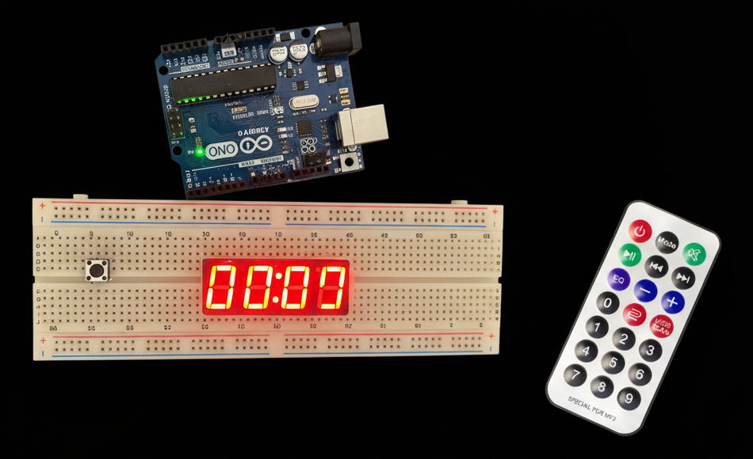

# ⏱️ Arduino IR Countdown Timer


A countdown timer of up to 99 minutes, controlled with an **infrared remote** and shown on a **4-digit 7-segment display** as `MM.SS`.


<sub>AI-generated illustration of the build.</sub>

## How it works

- At start-up, or after a reset, the display shows two horizontal bars on each digit.
- **Start/pause** sets the timer to 60:00, then starts and pauses the countdown.
- **+ / −** change the time by 10 minutes, or by 1 minute below 10 minutes and near the 99-minute limit.
- **Reset** stops the timer and goes back to the bars.
- When the countdown reaches 00:00, the whole display blinks until you set a new time.

The four digits are **multiplexed**: the sketch lights one digit at a time for 2 ms and cycles through them continuously.
The countdown uses `millis()` instead of `delay()`, so the display keeps refreshing and the remote stays responsive while it counts.
Repeated IR codes within 300 ms are ignored, so holding a button down doesn't jump several steps.

## Hardware

- Arduino Uno (or Nano)
- 4-digit 7-segment display, common cathode
- IR receiver (e.g. VS1838B) and a small NEC remote, like the 21-key ones in Arduino kits
- Breadboard and jumper wires, plus current-limiting resistors for the segments

## Wiring

| Arduino pin | Connected to |
| --- | --- |
| 2 – 8 | Segments A – G |
| A5 | Decimal point |
| 9 – 12 | Digits 1 – 4 (common pins) |
| 13 | IR receiver OUT (VCC to 5V, GND to GND) |

## Remote commands

| IR command | Action |
| --- | --- |
| `0x43` | Set 60:00 / start / pause |
| `0x44` | Reset |
| `0x15` | Add time |
| `0x07` | Remove time |

Which button sends which code depends on the remote. Open the Serial Monitor at 115200 baud: every button you press is printed as `Command received: 0x..`. Then change the `CMD_*` constants at the top of the sketch to the buttons you want.

## Running it

Install the **IRremote** library (Library Manager → *IRremote* by Armin Joachimsmeyer, version 4.x), open `Arduino_Timer.ino`, choose **Arduino Uno** and click **Upload**.

Or with [arduino-cli](https://arduino.github.io/arduino-cli/):

```bash
arduino-cli core install arduino:avr
arduino-cli lib install IRremote
arduino-cli compile -b arduino:avr:uno --upload -p <port> .
```
